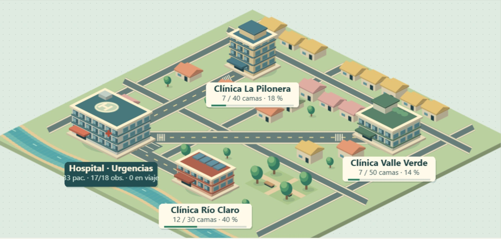
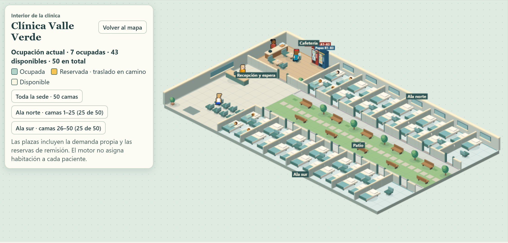
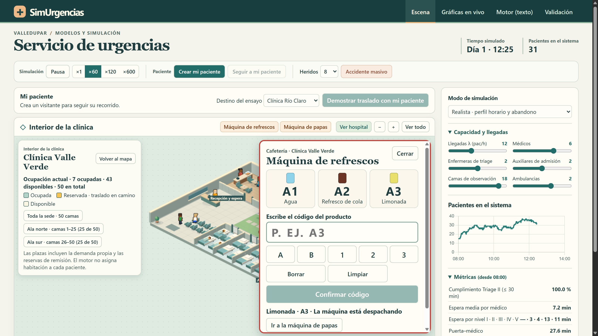
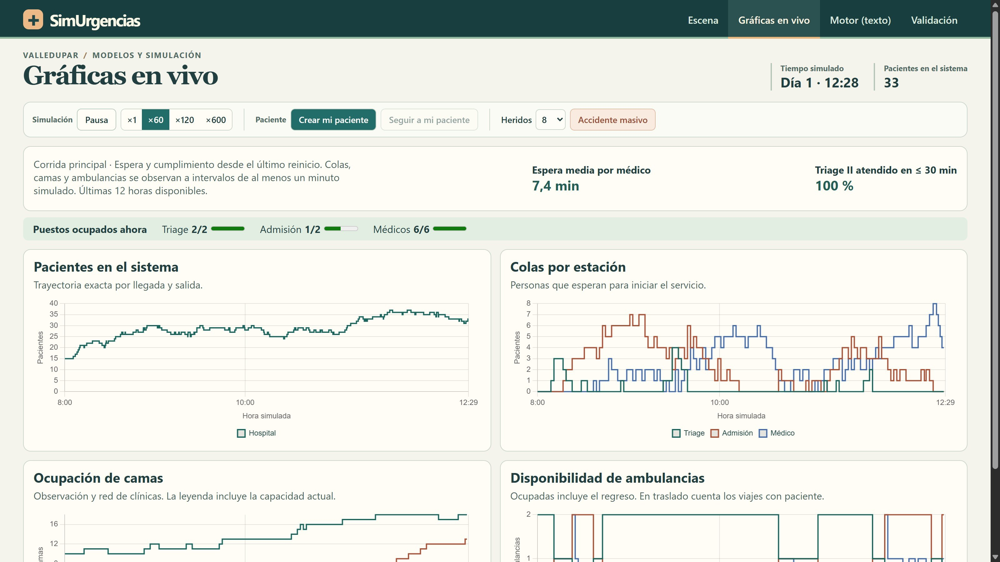
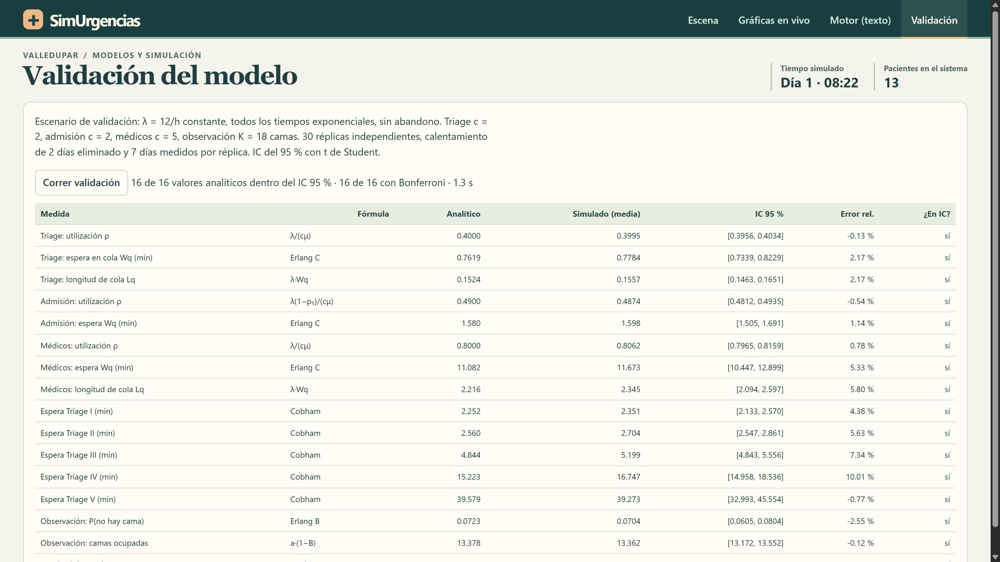

# SimUrgencias

Simulador de eventos discretos (SED) del servicio de urgencias de un hospital de Valledupar (Colombia), **validado contra teoría de colas** (Erlang C, Cobham, Erlang B, Ley de Little) y presentado como juego isométrico en el navegador. Proyecto de Modelos y Simulación — Ingeniería de Sistemas.

> EPS, clínicas y parámetros son **ficticios / estimados con fines académicos**. El orden triage → admisión sigue la Resolución 5596 de 2015 (art. 6).

## Capturas
| Hospital en vivo | Mapa de la ciudad |
|---|---|
|  |  |
| **Interior de una clínica** | **Máquina de la cafetería** |
|  |  |
| **Gráficas en vivo** | **Validación contra teoría de colas** |
|  |  |

Más capturas en [`docs/capturas`](docs/capturas) (incluida la vista de celular). Los gráficos del póster de Exposoftware 2026-2 están en [`docs/poster`](docs/poster).

## Uso
```bash
npm install
npm run dev        # desarrollo: http://localhost:5173
npm test           # 155 pruebas, incluida la validación analítica (30 réplicas)
npm run report     # escribe docs/VALIDACION.md (tabla analítico vs simulado con IC 95 %)
npm run build && npm run preview   # versión de presentación, funciona sin internet
npm run red-vial   # regenera calles, rutas y grafo vial de Valledupar desde OpenStreetMap (requiere internet)
npm run prehospital-experimento   # experimentos A–D del paciente en el mapa (docs/EXPERIMENTO_PREHOSPITALARIO.md)
```

## Red hospitalaria de Valledupar (`?red`)
Escenario adicional con sedes reales (REPS), calles y rutas viales de OpenStreetMap: abre `http://localhost:5173/?red` (o elige «Red Valledupar» en el panel). Cada remisión elige destino por compatibilidad clínica, cama simulada y ruta, y explica las sedes descartadas; la ambulancia recorre la ruta real en el mapa. Vistas «Mapa», «Satélite» (nítido con internet; imagen local de 10 m sin conexión) y «Solo calles»; tecla F para pantalla completa. La ocupación es simulada, no la real. Detalles: [`docs/RED_VALLEDUPAR.md`](docs/RED_VALLEDUPAR.md) · guía del stand: [`docs/GUIA_DEMO_RED.md`](docs/GUIA_DEMO_RED.md).

**Fase 2 (paciente en el mapa).** En la vista **Ciudad** se arrastra el muñeco a cualquier punto de Valledupar, o se hace clic en él y luego en el mapa.
- **Punto:** se valida (río, fuera del área, lejos de una vía) y se ajusta a la vía más cercana.
- **Formulario:** condición, triage del escenario, estabilidad y EPS real.
- **Recomendación:** el motor compara las 12 instituciones con rutas desde ese punto (Dijkstra sobre el grafo OSM, sentidos únicos, tráfico supuesto) y recomienda una explicando el porqué. Se compara con las políticas «más cercana» y «compatible más cercana».
- **Traslado:** el motor despacha una ambulancia y el **Seguimiento del paciente** muestra cada etapa con sus tiempos.
- **Fichas de institución:** en pestañas (General, Servicios, EPS, Capacidad, Fuentes), separando lo documentado de lo simulado.
- **Todo funciona sin internet.**
- **Documentación:**
  - [`MODELO_PREHOSPITALARIO.md`](docs/MODELO_PREHOSPITALARIO.md) (rutas, tráfico y selección);
  - [`EPS_VALLEDUPAR.md`](docs/EPS_VALLEDUPAR.md) (EPS y matriz EPS–IPS con fuentes);
  - [`NORMATIVA.md`](docs/NORMATIVA.md);
  - [`DISENO_INTERFAZ.md`](docs/DISENO_INTERFAZ.md);
  - [`EXPERIMENTO_PREHOSPITALARIO.md`](docs/EXPERIMENTO_PREHOSPITALARIO.md).

## Estructura
| Carpeta | Contenido |
|---|---|
| `src/engine` | Núcleo SED: reloj y lista de eventos (heap), generador sfc32 con flujos, distribuciones, recursos, estadísticas, contrato de eventos |
| `src/model` | Red de urgencias, parámetros (modo validación / realista), EPS y clínicas ficticias |
| `src/validation` | Fórmulas analíticas, IC t-Student, Kolmogorov-Smirnov, tabla de validación |
| `src/batch` | Réplicas independientes (Web Worker) |
| `src/render`, `src/ui` | Escenas (hospital, ciudad, interiores), panel, creador, gráficas en vivo |
| `src/model/valledupar` | Red real: sedes (REPS), matriz de recepción, calles y rutas de OpenStreetMap |
| `docs/` | `SPEC.md` (especificación), `TAREAS.md`, `HANDOFF.md`, `VALIDACION.md` |

Trabajo con varias IAs: ver `AGENTS.md`.
