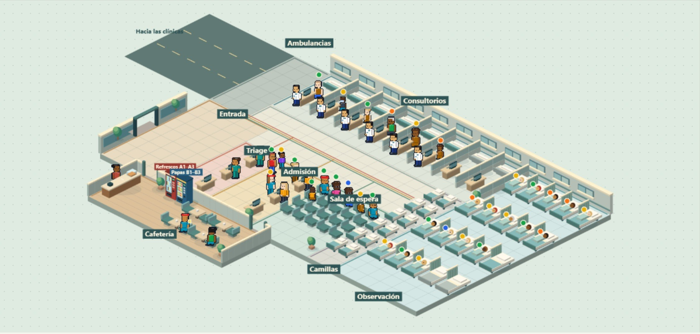

# SimUrgencias

Simulador de eventos discretos (SED) del servicio de urgencias de un hospital de Valledupar (Colombia), **validado contra teoría de colas** (Erlang C, Cobham, Erlang B, Ley de Little) y presentado como juego isométrico en el navegador. Proyecto de Modelos y Simulación — Ingeniería de Sistemas.

> EPS, clínicas y parámetros son **ficticios / estimados con fines académicos**. El orden triage → admisión sigue la Resolución 5596 de 2015 (art. 6).

## Capturas
| Hospital en vivo | Mapa de la ciudad |
|---|---|
|  |  |
| **Interior de una clínica** | **Máquina de la cafetería** |
|  |  |
| **Gráficas en vivo** | **Validación contra teoría de colas** |
|  |  |

Más capturas en [`docs/capturas`](docs/capturas) (incluida la vista de celular). Los gráficos del póster de Exposoftware 2026-2 están en [`docs/poster`](docs/poster).

## Uso
```bash
npm install
npm run dev        # desarrollo: http://localhost:5173
npm test           # 50 pruebas, incluida la validación analítica (30 réplicas)
npm run report     # escribe docs/VALIDACION.md (tabla analítico vs simulado con IC 95 %)
npm run build && npm run preview   # versión de presentación, funciona sin internet
```

## Estructura
| Carpeta | Contenido |
|---|---|
| `src/engine` | Núcleo SED: reloj y lista de eventos (heap), generador sfc32 con flujos, distribuciones, recursos, estadísticas, contrato de eventos |
| `src/model` | Red de urgencias, parámetros (modo validación / realista), EPS y clínicas ficticias |
| `src/validation` | Fórmulas analíticas, IC t-Student, Kolmogorov-Smirnov, tabla de validación |
| `src/batch` | Réplicas independientes (Web Worker) |
| `src/render`, `src/ui` | Escena isométrica y panel (en construcción) |
| `docs/` | `SPEC.md` (especificación), `TAREAS.md`, `HANDOFF.md`, `VALIDACION.md` |

Trabajo con varias IAs: ver `AGENTS.md`.
