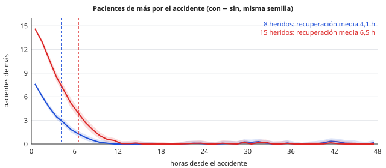

# Accidente masivo: tiempo de recuperación (T17)

Generado automáticamente con `npm run accidente` el 2026-11-22.

**Pregunta:** si llegan de golpe N heridos (Triage I–III), ¿cuánto tarda el servicio en volver a funcionar como si no hubiera pasado nada?

**Definición (SPEC §2.6, ajustada):** la SPEC mide hasta que N(t) "vuelve a ±10 % del nivel previo". Con llegadas que cambian según la hora (NHPP), el nivel previo no sirve de referencia: a media mañana N sube aunque no haya accidente. Por eso cada réplica se corre **dos veces con la misma semilla** (números aleatorios comunes): con accidente y sin él. La recuperación es el primer instante, desde 30 min después del accidente, en que el promedio temporal de N en los últimos 30 min con accidente queda a ±10 % del mismo promedio sin accidente.

**Diseño:** modo realista (6 médicos, 2 enfermeras de triage, 2 auxiliares de admisión, 18 camas); accidente el día 2 a las 10:00; 200 réplicas (semillas 4000–4199) por tamaño; 48 h de seguimiento. IC del 95 % con t de Student.

## Resultados

| Heridos | Recuperación media (h) [IC 95 %] | Mediana (h) | Percentil 90 (h) | Sin recuperar en 48 h | Curva media dentro del 10 % desde la hora |
|---|---|---|---|---|---|
| 8 | 4,1 [3,8; 4,5] | 3,6 | 7,1 | 0 de 200 | 4 |
| 15 | 6,5 [6,2; 6,9] | 6,3 | 10,3 | 0 de 200 | 7 |

## Lectura

- **8 heridos:** en promedio el servicio tarda **4,1 h** en recuperarse (IC 95 %: 3,8 a 4,5 h); en el 10 % de los casos más lentos, más de 7,1 h.
- **15 heridos:** en promedio el servicio tarda **6,5 h** en recuperarse (IC 95 %: 6,2 a 6,9 h); en el 10 % de los casos más lentos, más de 10,3 h.
- La recuperación de una corrida es muy variable: depende de qué tan cargado estaba el servicio a esa hora y de cuántos heridos requieren observación o remisión. Por eso se reporta la media con IC y el percentil 90, no un único número.

En la aplicación, el botón "Accidente masivo" mide lo mismo **en vivo** con un gemelo del hospital (misma semilla, sin accidente) que corre en paralelo.

Parámetros estimados con fines académicos; EPS y clínicas ficticias.

Tiempo de cómputo: 17 s.
