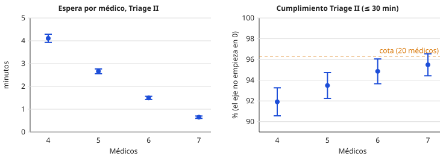

# Experimento: número de médicos (T14)

Generado automáticamente con `npm run experiment` el 2026-11-22.

**Pregunta:** ¿cuántos médicos necesita el servicio para atender a tiempo el Triage II (Res. 5596 de 2015: ≤ 30 min)?

**Diseño:** modo realista (perfil horario NHPP con λ media = 12/h, consulta Gamma con media 20 min y CV 0,6, abandono en IV–V); triage c = 2, admisión c = 2, 18 camas de observación. Escenarios: 4, 5, 6, 7 médicos, más 20 médicos como cota (cola del médico prácticamente nula). 30 réplicas por escenario, calentamiento de 1 día eliminado, 7 días medidos. IC del 95 % con t de Student (ν = 29).

**Números aleatorios comunes (CRN):** la réplica *i* de todos los escenarios usa la semilla 2000 + *i*. Cada proceso aleatorio (llegadas, mezcla de triage, servicio de cada estación, enrutamiento, paciencia…) tiene su propio flujo, así que las llegadas y sus niveles de triage son idénticos entre escenarios. Las diferencias contra el escenario actual (6 médicos) se estiman réplica a réplica (IC pareado).

## Resultados por escenario (media [IC 95 %])

| Médicos | Espera Triage II (min) | Cumplimiento Triage II (%) | Puerta–médico (min) | Abandono IV–V (%) | Utilización médicos (%) |
|---|---|---|---|---|---|
| 4 | 4,11 [3,93; 4,29] | 91,9 [90,6; 93,3] | 37,5 [36,0; 38,9] | 49,1 [47,4; 50,9] | 80,7 [80,2; 81,2] |
| 5 | 2,66 [2,56; 2,77] | 93,5 [92,2; 94,7] | 26,5 [25,6; 27,3] | 22,1 [21,0; 23,3] | 73,0 [72,5; 73,5] |
| 6 (actual) | 1,49 [1,42; 1,56] | 94,9 [93,7; 96,0] | 20,6 [19,9; 21,3] | 7,2 [6,6; 7,9] | 64,7 [64,1; 65,3] |
| 7 | 0,65 [0,60; 0,70] | 95,5 [94,4; 96,5] | 17,9 [17,4; 18,4] | 1,6 [1,4; 1,8] | 56,8 [56,1; 57,4] |
| 20 (cota) | 0,00 [0,00; 0,00] | 96,3 [95,3; 97,3] | 16,7 [16,2; 17,1] | 0,0 [0,0; 0,0] | 20,0 [19,8; 20,2] |

## Diferencias pareadas contra 6 médicos (media [IC 95 %])

| Médicos | Δ espera Triage II (min) | ¿Signif.? | Var. CRN / indep. | Δ cumplimiento (pp) | ¿Signif.? | Var. CRN / indep. |
|---|---|---|---|---|---|---|
| 4 − 6 | 2,61 [2,43; 2,79] | sí | 0,86 | -2,94 [-3,54; -2,34] | sí | 0,11 |
| 5 − 6 | 1,17 [1,07; 1,27] | sí | 0,62 | -1,37 [-1,78; -0,96] | sí | 0,06 |
| 7 − 6 | -0,84 [-0,90; -0,78] | sí | 0,47 | 0,63 [0,37; 0,90] | sí | 0,03 |

"Var. CRN / indep." = Var(X − Y) / (Var X + Var Y): la fracción de la varianza de la diferencia que queda al usar CRN frente a réplicas independientes. Un valor de 0,10 equivale a necesitar unas 10 veces menos réplicas para la misma precisión.

En la figura los IC del cumplimiento de escenarios vecinos se solapan, pero las diferencias pareadas son todas significativas: comparar escenarios réplica a réplica (CRN) elimina la variabilidad de las llegadas, que es común a ambos.

## Lectura

- **Espera del Triage II por médico:** pasa de 4,11 min con 4 médicos a 0,65 min con 7. Es baja en todos los escenarios porque el Triage II tiene prioridad sobre III–V en la cola del médico.
- **Cumplimiento:** mide la espera desde el fin del triage hasta el médico, así que incluye la cola y el servicio de admisión. Ni con 20 médicos supera el 96,3 %: el límite lo pone la **admisión** (espera media 4,57 min, 2 auxiliares), no los médicos. Agregar médicos más allá de 6 mejora poco el cumplimiento.
- **Costo oculto de pocos médicos:** con 4 médicos el Triage II sigue protegido por la prioridad, pero el abandono de IV–V sube a 49,1 % y la espera puerta–médico a 37,5 min.
- **Sincronización parcial de CRN:** los tiempos de servicio se toman de su flujo al empezar cada atención, y el orden de atención cambia con el número de médicos. Por eso la ganancia de CRN es grande en cumplimiento y utilización pero moderada en la espera del Triage II.

Parámetros estimados con fines académicos; EPS y clínicas ficticias.

Tiempo de cómputo: 2.3 s.
