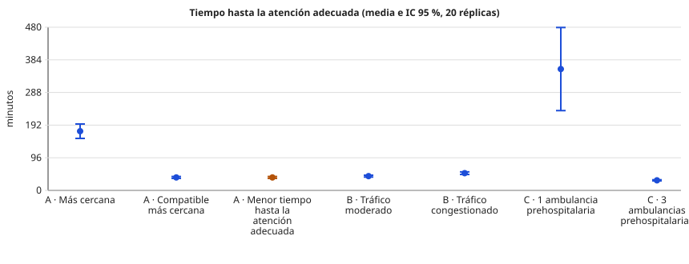

# Experimento: paciente prehospitalario en Valledupar (T33)

Generado automáticamente con `npm run prehospital-experimento` el 2026-11-24.

**Preguntas:**
- (A) ¿Cuánto cambia el tiempo hasta la atención adecuada según la política de selección del destino?
- (B) ¿Cuánto lo cambia el tráfico?
- (C) ¿Cuánto lo cambia el número de ambulancias prehospitalarias?
- (D) ¿Cuánto lo cambia el sector de la ciudad?

**Diseño:**
- Motor completo del escenario de red (`?red`): sedes reales, camas por tipo, CRUE y remisiones.
- 20 réplicas por escenario, 5 días con llegadas de pacientes al mapa; luego se deja terminar a los que están en curso. IC del 95 % con t de Student (ν = 19).
- **Números aleatorios comunes:** en la réplica *i*, todos los escenarios reciben los mismos pacientes (instante, punto, condición y triage) y el motor usa la misma semilla (7000 + *i*). Las diferencias contra la referencia se estiman réplica a réplica.

**Supuestos (no hay datos de Valledupar):**
- Llegadas de pacientes al mapa: Poisson de 1,5 por hora.
- Punto uniforme sobre la longitud de la red vial.
- Condición según la mezcla de remisiones del escenario de red.
- Triage I, II y III con 25, 50 y 25 %; el triage III se considera estable y I–II críticos.
- EPS no simulada, para aislar los criterios clínicos y geográficos.
- Velocidades por clase de vía (50, 45, 40, 35, 30, 25, 15 km/h) y factores de tráfico (moderado ×1.3…, congestionado ×1.8…).
- Escena de 12 min, estabilización de 60 min, CRUE de 30 min y entrega de 15 min (medias).

**Medidas:**
- **Primera atención:** desde que se crea el paciente hasta que llega a la primera sede.
- **Atención adecuada:** llegada a una sede con atención definitiva y cama del tipo requerido (directa o tras estabilizar y remitir).
- «Llegan a la atención adecuada» excluye a quienes se resolvieron dentro de urgencias del hospital de origen sin remisión (el modelo de urgencias decide su salida) y a quienes quedaron sin destino.

## Resultados por escenario (media [IC 95 %])

| Escenario | Tiempo hasta la primera atención (min) | Tiempo hasta la atención adecuada (min) | Llegan a la atención adecuada (%) | Necesitan un segundo traslado (%) | Espera por ambulancia (min) | Distancia recorrida con el paciente (km) | Uso de ambulancias prehospitalarias (%) | Sin destino en la red (%) |
|---|---|---|---|---|---|---|---|---|
| A · Más cercana | 51,1 [41,5; 60,7] | 174,1 [152,9; 195,3] | 98,2 [97,6; 98,8] | 92,5 [91,4; 93,5] | 27,8 [18,4; 37,2] | 4,4 [4,3; 4,5] | 74,1 [70,4; 77,8] | 1,8 [1,2; 2,4] |
| A · Compatible más cercana | 33,4 [31,2; 35,6] | 38,1 [35,4; 40,8] | 98,4 [97,9; 98,9] | 1,2 [0,7; 1,6] | 8,6 [6,6; 10,6] | 4,0 [4,0; 4,1] | 50,6 [47,8; 53,4] | 1,6 [1,1; 2,1] |
| A · Menor tiempo hasta la atención adecuada (referencia) | 33,4 [31,2; 35,6] | 38,1 [35,4; 40,8] | 98,4 [97,9; 98,9] | 1,2 [0,7; 1,6] | 8,6 [6,6; 10,6] | 4,0 [4,0; 4,1] | 50,6 [47,8; 53,4] | 1,6 [1,1; 2,1] |
| B · Tráfico moderado | 37,9 [35,3; 40,4] | 42,0 [39,3; 44,6] | 98,4 [97,8; 99,0] | 1,1 [0,7; 1,4] | 10,4 [8,1; 12,6] | 3,9 [3,9; 4,0] | 53,8 [51,0; 56,6] | 1,6 [1,0; 2,2] |
| B · Tráfico congestionado | 47,2 [43,2; 51,2] | 50,7 [46,9; 54,5] | 98,1 [97,5; 98,8] | 0,8 [0,5; 1,1] | 15,5 [12,0; 19,1] | 3,8 [3,7; 3,9] | 59,5 [56,3; 62,6] | 1,9 [1,2; 2,5] |
| C · 1 ambulancia prehospitalaria | 349,7 [228,9; 470,5] | 356,9 [234,7; 479,1] | 98,6 [98,1; 99,2] | 1,2 [0,7; 1,6] | 324,8 [204,2; 445,3] | 4,0 [3,9; 4,1] | 93,0 [90,0; 96,0] | 1,4 [0,8; 1,9] |
| C · 3 ambulancias prehospitalarias | 26,2 [25,5; 26,9] | 29,6 [28,0; 31,2] | 98,3 [97,6; 99,0] | 0,9 [0,6; 1,2] | 1,3 [1,0; 1,6] | 4,0 [3,9; 4,1] | 33,7 [31,8; 35,5] | 1,7 [1,0; 2,4] |

## Diferencias pareadas contra la referencia (menor tiempo hasta la atención adecuada, tráfico fluido, 2 ambulancias)

| Escenario − referencia | Δ primera atención (min) | ¿Signif.? | Δ atención adecuada (min) | ¿Signif.? | Δ segundo traslado (pp) | ¿Signif.? |
|---|---|---|---|---|---|---|
| A · Más cercana | 17,7 [9,6; 25,8] | sí | 136,0 [116,0; 155,9] | sí | 91,3 [90,1; 92,5] | sí |
| A · Compatible más cercana | 0,0 [0,0; 0,0] | no | 0,0 [0,0; 0,0] | no | 0,0 [0,0; 0,0] | no |
| B · Tráfico moderado | 4,5 [3,8; 5,1] | sí | 3,9 [2,3; 5,5] | sí | -0,1 [-0,5; 0,2] | no |
| B · Tráfico congestionado | 13,8 [11,9; 15,8] | sí | 12,6 [10,3; 14,8] | sí | -0,4 [-0,7; -0,0] | sí |
| C · 1 ambulancia prehospitalaria | 316,3 [196,7; 436,0] | sí | 318,8 [197,5; 440,0] | sí | -0,0 [-0,4; 0,3] | no |
| C · 3 ambulancias prehospitalarias | -7,2 [-8,8; -5,5] | sí | -8,5 [-10,3; -6,7] | sí | -0,3 [-0,6; -0,0] | sí |

## D · Por sector de la ciudad (escenario de referencia)

| Sector (distancia en línea recta al hospital de origen, base de las ambulancias) | Primera atención (min) | Ambulancia hasta el paciente (min) |
|---|---|---|
| centro (< 1,5 km) | 26,4 [24,4; 28,4] | 2,7 [2,6; 2,7] |
| intermedio (1,5–3 km) | 30,2 [28,3; 32,1] | 5,2 [5,1; 5,3] |
| periferia (> 3 km) | 38,3 [35,9; 40,8] | 9,1 [8,9; 9,2] |

## Lectura

- **Políticas (A):**
  - «Más cercana» lleva primero a la urgencia más próxima. Así la primera atención cambia en 17,7 min, pero la atención adecuada cambia en 136,0 min (sí significativo), con 92,5 % de segundos traslados.
  - «Compatible más cercana» difiere de la referencia en 0,0 min (no significativo). Sin EPS y con camas disponibles, la sede definitiva más cercana suele ser también la de menor tiempo. Las dos políticas se separan cuando conviene estabilizar primero a un paciente crítico o cuando cuenta la red de la EPS de un paciente estable.
  - Este es el contraste que muestra el valor del algoritmo frente al «paseo de la muerte».
- **Tráfico (B):** con tráfico congestionado, la atención adecuada cambia en 12,6 min (sí significativo).
- **Ambulancias (C):**
  - con 1 ambulancia, la espera por ambulancia es de 324,8 min, frente a 8,6 min en la referencia;
  - con 3, la atención adecuada cambia en -8,5 min (sí significativo);
  - uso de las ambulancias en la referencia: 50,6 %. Con una sola ambulancia, su uso (93,0 %) se acerca a la saturación y la cola crece: por eso el intervalo es tan ancho.
- **Sector (D):** la periferia tarda más porque la base de las ambulancias está en el centro (hospital de origen). Varias bases es un P2.

**Validez:** la validación con teoría de colas del escenario original **no** valida este modelo georreferenciado. Lo que se verificó para él son propiedades en las pruebas (`tests/prehospital.test.ts`, `tests/valledupar-router.test.ts`):
- rutas por vías existentes y sentidos;
- conservación de λ;
- camas ≤ capacidad;
- reproducibilidad;
- orden de los tiempos.

Las cifras dependen de los supuestos anteriores. Escenario académico: no describe la disponibilidad real de ninguna institución ni el tráfico real.

Tiempo de cómputo: 559.7 s.
