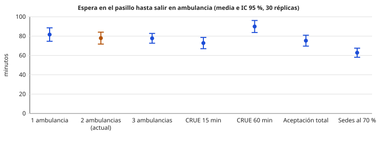

# Experimento: red hospitalaria de Valledupar (T27)

Generado automáticamente con `npm run red-experimento` el 2026-11-24.

**Pregunta:** ¿qué limita más el tiempo que un paciente espera en el pasillo para ser remitido: las ambulancias, la coordinación con el CRUE o la aceptación de las sedes?

**Diseño:** escenario de red (`?red`): sedes reales con una unidad por tipo de cama documentado (camas de adulto, UCI adulto, pediátrica y neonatal, quemados), ocupación propia del 90 % (supuesto), selección del destino por compatibilidad, cama del tipo que la condición necesita y ruta vial, aceptación simulada (AD 85 %, C 50 %; supuesto). 30 réplicas por escenario, calentamiento de 1 día eliminado, 7 días medidos; IC del 95 % con t de Student (ν = 29). **Números aleatorios comunes:** la réplica *i* de todos los escenarios usa la semilla 5000 + *i*; las diferencias contra el escenario actual se estiman réplica a réplica.

## Resultados por escenario (media [IC 95 %])

| Escenario | Espera en el pasillo hasta la ambulancia (min) | Remitidos fuera de la red (% de llegadas) | Traslados por día | Uso de ambulancias (%) |
|---|---|---|---|---|
| 1 ambulancia | 79,0 [72,6; 85,3] | 0,42 [0,37; 0,46] | 16,4 [15,8; 17,0] | 20,2 [19,4; 20,9] |
| 2 ambulancias (actual) | 78,8 [72,5; 85,1] | 0,43 [0,39; 0,48] | 16,5 [15,9; 17,2] | 10,1 [9,8; 10,5] |
| 3 ambulancias | 78,4 [71,9; 84,9] | 0,42 [0,39; 0,46] | 16,7 [16,0; 17,3] | 6,8 [6,6; 7,1] |
| CRUE 15 min | 70,9 [63,8; 77,9] | 0,40 [0,35; 0,45] | 16,4 [15,8; 17,0] | 10,1 [9,7; 10,5] |
| CRUE 60 min | 93,8 [87,5; 100,1] | 0,41 [0,37; 0,46] | 16,1 [15,5; 16,8] | 9,9 [9,5; 10,2] |
| Aceptación total | 73,7 [68,7; 78,6] | 0,41 [0,36; 0,46] | 16,6 [16,1; 17,2] | 10,2 [9,8; 10,6] |
| Sedes al 70 % | 62,9 [58,0; 67,8] | 0,35 [0,30; 0,41] | 17,0 [16,5; 17,5] | 10,4 [10,0; 10,7] |

## Diferencias pareadas contra el escenario actual

| Escenario − actual | Δ espera (min) | ¿Signif.? | Var. CRN / indep. | Δ fuera de la red (pp) | ¿Signif.? |
|---|---|---|---|---|---|
| 1 ambulancia | 0,2 [-5,3; 5,6] | no | 0,37 | -0,02 [-0,06; 0,03] | no |
| 3 ambulancias | -0,4 [-4,1; 3,3] | no | 0,16 | -0,01 [-0,05; 0,03] | no |
| CRUE 15 min | -7,9 [-15,3; -0,6] | sí | 0,61 | -0,03 [-0,07; 0,01] | no |
| CRUE 60 min | 15,0 [9,2; 20,7] | sí | 0,42 | -0,02 [-0,06; 0,02] | no |
| Aceptación total | -5,2 [-10,2; -0,1] | sí | 0,40 | -0,02 [-0,07; 0,03] | no |
| Sedes al 70 % | -15,9 [-22,0; -9,8] | sí | 0,58 | -0,08 [-0,14; -0,02] | sí |

"Var. CRN / indep." = Var(X − Y) / (Var X + Var Y): fracción de la varianza que queda al comparar con números aleatorios comunes.

## Lectura

- **Ambulancias:** con 1 la espera es 79,0 min; con 3, 78,4 min (actual: 78,8 min); diferencias no significativas. Las ambulancias se usan el 10 % del tiempo: no son el cuello de botella.
- **CRUE:** pasar de 30 a 15 min de coordinación cambia la espera en -7,9 min (sí significativo); a 60 min, en 15,0 min (sí significativo).
- **Aceptación:** si todas las sedes aceptaran a la primera, la espera cambiaría en -5,2 min (sí significativo).
- **Camas:** con las sedes al 70 % de ocupación en vez del 90 %, la espera cambia en -15,9 min (sí significativo) y los remitidos fuera de la red en -0,08 pp.
- **Fuera de la red** (corrida de 30 días, semilla 1): Crisis psiquiátrica estable 40, Quemadura extensa o grave 8, Niño crítico 3.
- La espera incluye a quienes quedaron en el pasillo por falta de cama de observación en el hospital de origen.

Escenario académico: capacidades documentadas (REPS); ocupación, aceptación, tiempos de coordinación y de entrega son supuestos. No describe la disponibilidad real de ninguna institución.

Tiempo de cómputo: 13.1 s.
