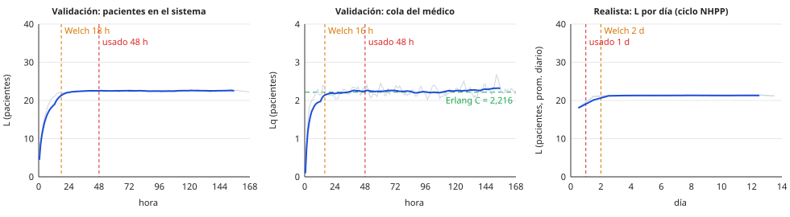

# Calentamiento: método gráfico de Welch (T15)

Generado automáticamente con `npm run welch` el 2026-11-22.

**Pregunta:** ¿cuánto tiempo hay que descartar al inicio de cada réplica (el sistema arranca vacío) para medir el estado estable? Los informes de referencia usan una "regla de 48 h" sin justificarla (SPEC §8.4).

**Método (Law & Kelton, §9.5.1):** 1000 réplicas independientes (semillas 3000–3999) que arrancan vacías. En cada periodo *j* se mide el promedio temporal exacto de la variable (las estadísticas se reinician al inicio del periodo). Se promedia entre réplicas (Ȳ_j) y se suaviza con la media móvil de Welch de ventana *w*. El calentamiento *l* es el primer periodo desde el cual la curva suavizada queda **siempre** dentro de ±5 % del nivel estable (media de la segunda mitad).

**Variables:** L = pacientes en el sistema (incluye observación, el componente más lento: estancia media de 6 h) y Lq = cola del médico. No se usa la espera media por periodo: es un cociente (suma de esperas / pacientes atendidos) que pondera igual las horas tranquilas y las congestionadas y queda sesgado (≈ 9,0 min contra 11,08 min de Erlang C con estos datos).

**Modo realista:** las llegadas siguen un perfil horario (NHPP) que se repite cada día, así que el proceso nunca es estacionario hora a hora. Se aplica Welch a los **promedios diarios**, que sí son estacionarios en régimen (Law & Kelton, parámetros de ciclo en estado estable).

## Resultados

| Modo | Variable | Periodo | w | Nivel estable | Calentamiento de Welch | Calentamiento usado |
|---|---|---|---|---|---|---|
| Validación | L | 1 h | 12 | 22,52 | **18 h** | 48 h |
| Validación | Lq médico | 1 h | 12 | 2,251 (Erlang C: 2,216) | **16 h** | 48 h |
| Realista | L | 1 día | 1 | 21,31 | **2 día(s)** | 1 día |
| Realista | Lq médico | 1 día | 1 | 1,002 | 0 día(s) | 1 día |

Promedios diarios de L en el modo realista: 18,04 · 21,04 · 21,25 · 21,30 · 21,32 · 21,28 · 21,34 · 21,29 · 21,33 · 21,34 · 21,23 · 21,34 · 21,41 · 21,20.

## Sesgo según el calentamiento (modo realista, L)

La media móvil con w = 1 mezcla el día 1 (15,3 % bajo el nivel) en el valor suavizado del día 2; por eso el criterio estricto marca 2 días. Sin suavizar, el día 2 queda a solo 1,3 % del nivel. Lo que importa es el sesgo que queda en lo que se mide (7 días tras el calentamiento):

| Calentamiento | Sesgo de L medido en 7 días |
|---|---|
| 0 día(s) | -2,42 % |
| 1 día(s) | -0,24 % |
| 2 día(s) | -0,05 % |
| 3 día(s) | 0,01 % |

## Conclusión

- **Modo validación:** Welch pide 18 h; se usan 48 h, más del doble. Es conservador: descartar de más solo cuesta cómputo, no introduce sesgo. Además el nivel de la cola del médico coincide con Erlang C (2,251 contra 2,216).
- **Modo realista:** el criterio estricto marca 2 día(s), pero con el calentamiento usado de 1 día el sesgo que queda en L es de -0,24 %, muy por debajo de la precisión de los IC del experimento T14 (semiamplitudes relativas de 1 % a 13 %). Se mantiene 1 día; si se quisiera sesgo prácticamente nulo, 2 días lo dejan en -0,05 %.
- La "regla de 48 h" de los informes queda justificada para el modo validación (con margen).

Tiempo de cómputo: 45 s.
